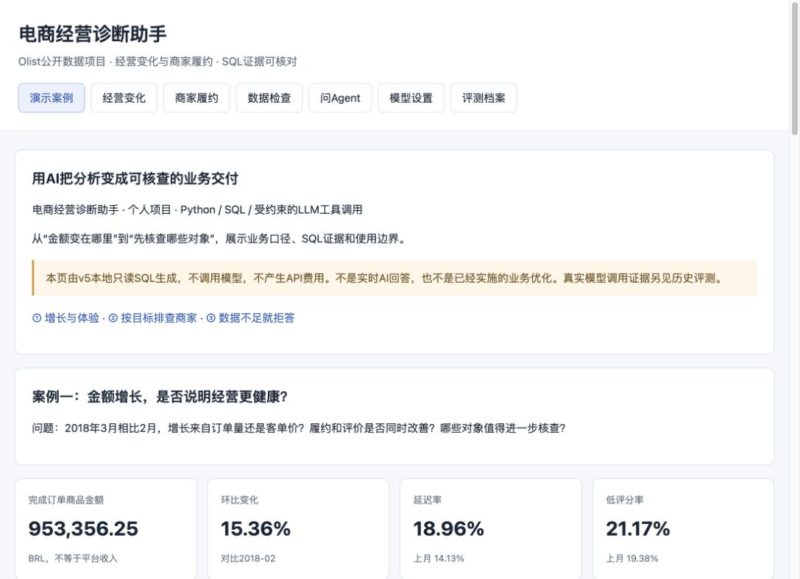

# 电商经营诊断助手

**把经营变化、商家排查和SQL证据连接起来的个人项目。** 基于Olist公开历史订单数据，使用Python、SQL和受约束的LLM工具调用，回答“变化在哪里、哪些对象优先核查、哪些结论数据不支持”。

适用方向：业务分析、数据驱动运营、AI应用运营。项目使用AI辅助编程实现；重点是业务口径、工具边界、证据校验与失败复盘，不是展示手写代码量。



## 先看案例

**[在线演示｜无需安装或API密钥](https://bobbyt-thx.github.io/ecommerce-ops-agent/)** · **[GitHub代码与方法](https://github.com/bobbyt-thx/ecommerce-ops-agent)**

- [免费静态演示](docs/demo/index.html)：下载项目后用浏览器打开，无需密钥；GitHub文件预览不会执行HTML，公开网页需要另行托管。
- [完整经营案例](docs/CASE_STUDY.md)：商品金额增长15.36%，但履约和评价指标同时恶化，下一步该查什么？
- [三分钟演示讲稿](docs/DEMO_SCRIPT.md)：按业务问题、证据和行动假设讲解。
- [真实模型评测摘要与原结果指纹](docs/evaluation-summary.json)：四轮历史验证保留，包含失败，不拼成“准确率提升曲线”。

本地启动后打开 `http://127.0.0.1:8765/demo`；公开版本通过上方在线演示访问。在线版是静态案例，不会运行Python服务或发起模型API调用。

## 两个业务场景

| 场景 | 输入与输出 | 业务边界 |
| --- | --- | --- |
| 经营变化诊断 | 指定月份对比上月，拆解订单量与客单价贡献，并查看品类、地区和商家切面 | 完成队列商品金额不是平台收入；算术贡献不是因果归因 |
| 商家履约与评价排查 | 指定区间、样本门槛和排序目标，返回待核查对象、样本量与SQL来源 | 多商家订单不直接归责；低样本指标不参与该排名；榜单不是处罚依据 |

示例：

```text
先检查2018-05至2018-07商家，门槛30单，再报告2018-08总体商品金额。
2018-05至2018-07，至少30单，哪些商家低评分率最高？
2018-03经营变化，再检查2018-03商家，门槛30单。
```

解析范围是有限的：每次最多一个经营月份与一个商家区间；任务窗口缺失或冲突时澄清，不承诺任意自然语言问数。

## 为什么不只是另一个看板

看板和SQL负责稳定计算；助手尝试把任务、工具和证据组织成可追溯交付。模型不直接生成或执行任意SQL，也不执行处罚、发券或其他运营动作。

```text
业务问题 → 任务片段与参数约定 → 可选LLM工具调用 → 只读SQL
        → 数值校验＋SQL来源绑定 → 具体对象与核查建议
```

- **指标可信**：99,441笔订单、112,650条商品明细；先分层归并再关联，避免多支付、多评价造成金额重复计算。对照错误直接联表方法，商品金额会被高估约5.02%，不是替企业追回了收入。
- **对象可核查**：按用户目标在完整合格样本内排序，再截取候选；展示实体绑定具体SQL结果行。
- **边界明确**：无成本、消费者访问或广告费用时，不把缺失值填成0，不用商家线索替代消费者访问。
- **失败透明**：保存原始模型草稿、工具轨迹、程序校验和分版评测；错误数字不自动用参考答案改正。

尚未证明相较BI的效率提升，尚无真实运营干预或收益验证。项目不是通用Text-to-SQL、RAG或多Agent系统。

## 当前验证状态

| 版本 | 内部检查通过 | 如何解读 |
| --- | --- | --- |
| v1 | 21/30 | 保留缺失广告费被当作0的真实失败 |
| v2 | 29/30 | 25道模型调用、5道规则拒答；新题库与新应用约束 |
| v3 | 15/20 | 保留错工具、误拒、口径及格式失败 |
| v4 | 10/10 | 6道模型调用、4道规则拒答；不是全文100%正确 |
| v5 | 本地回归，见技术报告 | 修复任务绑定、目标排序和实体交付；未追加API评测 |

历史题库和源码快照保留在本地归档，模型题、规则题与mock技术测试分别解释。不同轮次不能视作同一测试集上的精度提升。v5不继承v4分数。

本轮技术验证见 [technical_checks.json](reports/technical_checks.json)。旧技术快照保存在 `reports/baselines/v4/reports/technical_checks.json`；旧原始结果没有覆盖。

## 本地运行

Python 3.10及以上；准备数据需要pandas，分析服务主要使用标准库。

```sh
python3 -m pip install -r requirements.txt
# 从下方官方来源获取两个ZIP，原名放入data/raw/
python3 -m ops_agent.prepare
python3 -m unittest discover -s tests -v
python3 -m ops_agent.showcase
python3 -m ops_agent serve --port 8765
```

当前服务默认禁止新增模型请求，即使已有环境变量或配置密钥也不能通过网页调用。演示使用本地SQL，不产生API费用。模型协议实现与历史真实调用记录用于说明实现，不需要为了展示重新付费。

原始数据不会被覆盖，分析库只读；`.local/`、原始ZIP/CSV、SQLite及日常运行日志不应提交。完整历史评测与快照用于本机复核，公开版应先按[发布检查清单](docs/PUBLICATION_CHECKLIST.md)准备，不要直接上传整个工作目录。

## 数据来源与限制

- [Olist Brazilian E-Commerce](https://www.kaggle.com/datasets/olistbr/brazilian-ecommerce)
- [Olist Marketing Funnel](https://www.kaggle.com/datasets/olistbr/marketing-funnel-olist)

两份官方数据卡于2026-10-25复核，均显示CC BY-NC-SA 4.0。数据衍生分析、表格、截图和演示内容保留署名与加工说明，并按原许可共享；详见[第三方数据与权利说明](THIRD_PARTY_NOTICES.md)。原始数据不随代码分发。营销表只用于关联审计，没有用来伪造消费者漏斗。

数据来自2016–2018年巴西市场，不是当前经营。月度分析采用最终完成状态的下单队列，存在回溯筛选和尾部成熟度风险。所有行动仅为待核查假设；未控制品类、地区、距离等因素时不能认定商家责任。

## 项目结构

```text
ops_agent/       只读分析、任务约定、模型协议、校验与网页
tests/           数值、原始表参考SQL、边界和mock协议回归
docs/            展示页、案例、演示讲稿、评测摘要与发布清单
evals/           原冻结题库与清单（仅本地留存，公开包未附）
reports/         公开审计与技术摘要；完整调用结果和源码归档仅本地留存
scripts/         非覆盖归档及本地验收辅助工具
```

官方实现参考：[Function calling](https://developers.openai.com/api/docs/guides/function-calling)、[Evaluation best practices](https://developers.openai.com/api/docs/guides/evaluation-best-practices)。完整历史开发记录及原始轨迹保留于本机，不在本展示包中。
